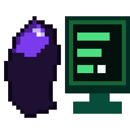

# Connect Obsidian

A small Windows app that connects [Obsidian](https://obsidian.md) to ChatGPT.

ChatGPT cannot reach Obsidian on your computer. This app runs [OpenAI's tunnel client](https://github.com/openai/tunnel-client) for you, adds your Obsidian API key on your machine, and keeps both keys out of the ChatGPT form.



## Share a built app

Build `dist\ConnectObsidian.exe` with the steps below, then share that file together with `dist\LICENSE`, `dist\LICENSE.tunnel-client`, and `dist\NOTICE.tunnel-client`. People do not install the tunnel program separately. The exe contains it and unpacks it on the first connection.

## What a person needs

- Windows 10 or later
- Obsidian, with the Local REST API community plugin turned on and **Enable insecure HTTP server** turned on
- An OpenAI Platform account with a [Secure MCP Tunnel](https://developers.openai.com/api/docs/guides/secure-mcp-tunnels) and an API key
- A ChatGPT account that can add a custom MCP server

## First-time setup

1. Open Obsidian and leave it open.
2. Run `ConnectObsidian.exe`.
3. Enter:
   - **Tunnel id**, from [platform tunnel settings](https://platform.openai.com/settings/organization/tunnels). It starts with `tunnel_`.
   - **OpenAI API key**, from [API keys](https://platform.openai.com/api-keys). It starts with `sk-`.
   - **Obsidian API key**, from **Obsidian → Settings → Local REST API**.
4. Leave the address as `http://127.0.0.1:27123/mcp/` unless your plugin uses another local port.
5. Press **Save**, then **Connect**.
6. In ChatGPT, add a custom MCP server:
   - Connection: **Tunnel**
   - Tunnel id: the same id
   - Authentication: **No authentication**

In a chat, type `@` and choose Obsidian. The window can be closed after it says **Connected**. It keeps running by the clock. Right-click that icon to disconnect.

The two keys are different. This app stores them encrypted for the current Windows account. Do not put the Obsidian key into ChatGPT.

## Build

From this folder, in PowerShell:

```powershell
powershell -NoProfile -ExecutionPolicy Bypass -File .\build.ps1
```

The script downloads tunnel-client `v0.0.18` for Windows from the official GitHub release, compiles the app, and writes:

- `dist\ConnectObsidian.exe`
- `dist\LICENSE`
- `dist\LICENSE.tunnel-client`
- `dist\NOTICE.tunnel-client`

Change `$Version` at the top of `build.ps1` when you want a newer tunnel-client release.

## License

The app source in this repository is MIT. See [LICENSE](LICENSE).

The built exe also contains [tunnel-client](https://github.com/openai/tunnel-client) and the [cloudflared](https://github.com/cloudflare/cloudflared) program shipped with it. Those projects are Apache License 2.0. Their notices are copied into `dist\` by the build. Keep those files with any copy of the exe you give to someone else.
